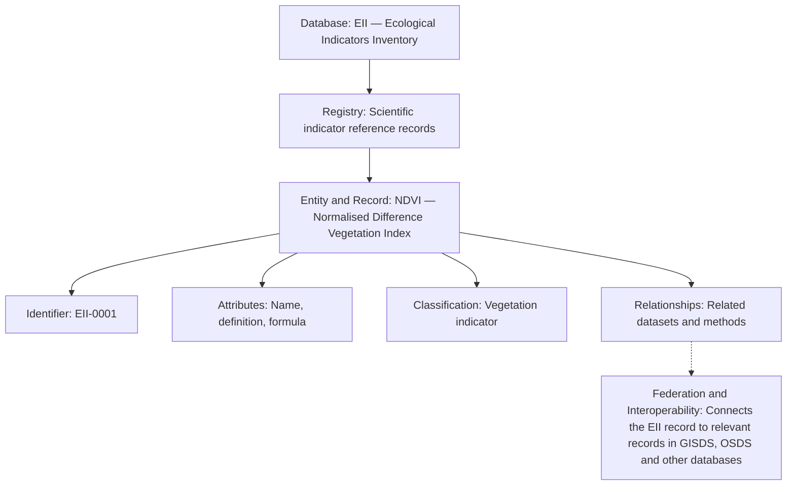

# Database Reference Methodology (DRM)

**Status:** Under development — shared research methodology.

The Database Reference Methodology supports the intended interoperability of
independently maintained research databases within Ecological Information.
It provides a place to develop guidance on portable classifications, shared
identifiers and explicit mappings, conceptual relationships, provenance and
cross-database analytical frameworks.

Individual databases retain authority over their own research content,
classifications, identifiers, evidence and schemas. Shared conventions should
make relationships explicit without requiring identical schemas or replacing
project-specific meanings. Cross-database analysis must preserve the distinction
between documented evidence, inference and research interpretation.

This introduction does not establish a detailed specification, implemented
federation or conformance standard. References elsewhere to DRM v1.0.0 do not
mean that an approved specification is available here. Detailed methodology
requires separate development and review. Any extension across other Ecological
Interaction research layers should retain these independent responsibilities.

See the [Ecological Information introduction and project catalogue](../README.md)
for the current research context.

## Status of this working material

The introduction above remains the current repository guidance. The following
working vocabulary and proposed introduction reproduce the supplied DRM Overview
text, with Markdown formatting added. Their use of “establishes”, “requirements”
and “enables” describes the intended methodology, not an approved specification,
verified conformance or an implemented federation.

Existing repository guidance preserves each project's authority over its own
content, identifiers, schemas and evidence, and distinguishes evidence, inference
and project interpretation. Detailed shared requirements, entity registries,
crosswalks, services and cross-database synthesis remain proposals for review.

Examples below are explanatory, not issued identifiers, approved mappings or
confirmation of implemented databases. References to IRKB and DPRKB describe
proposed or developing research directions. The supplied wording “EII — Ecological
Indicators Inventory” is retained in the conceptual example; the current umbrella
catalogue uses “Ecological Indicator Inventory”. No project renaming is proposed.

## DRM — Working Vocabulary

The Database Reference Methodology (DRM) establishes a common way to organise, describe, connect and maintain information across independent research databases.
The following is a preliminary glossary, using simple explanations and examples from EIRKB, EII, GISDS and OSDS. It combines the terminology established in our DRM research record with standard database terminology.

### 1. Fundamental database terms

| Term | Simple definition | Example |
| --- | --- | --- |
| Database | An organised collection of information that can be stored, searched and updated. | EII, GISDS, OSDS |
| Entity | A distinct thing or concept about which information is recorded. | A researcher, publication, sensor, indicator or geographic location |
| Record | The stored description of a particular entity. | A record describing the NDVI indicator |
| Identifier (ID) | A unique code used to distinguish one record or entity from another. | EII-0001 |
| Attribute / Field | A particular property or piece of information about an entity. | Name, date, author, description |
| Value | The actual information contained in a field. | 2026 in a year field |
| Registry / Register | An organised, maintained list of records, usually with identifiers and descriptive information. | EII Scientific Reference Register |
| Catalogue | A collection designed to help people discover and understand available resources. | A catalogue of geographic data sources |
| Dataset | A collection of related data, often measurements or observations. | Satellite-derived vegetation measurements |
| Schema | The rules defining what fields, types and relationships a database contains. | Every indicator record must have an ID, name and definition |

### 2. Classification and knowledge organisation

| Term | Simple definition | Example |
| --- | --- | --- |
| Domain | A subject area or field of knowledge. | Ecology, agriculture, systems science |
| Category | A grouping of entities sharing some characteristic. | Remote sensing indicators |
| Classification | A systematic way of organising entities into categories. | EIRKB's Historical Arc (HA) |
| Taxonomy | A classification organised into hierarchical groups. | Environmental science → Ecology → Landscape ecology |
| Ontology | A formal description of what kinds of things exist in a domain and how they relate. | Indicators measure ecological properties; instruments produce observations |
| Relationship | A defined connection between two entities. | A publication describes a method |
| Mapping | An explicit connection between elements in different systems or classifications. | Linking equivalent indicator categories in two databases |
| Knowledge base (KB) | An organised body of knowledge containing entities, concepts, relationships and supporting evidence. | EIRKB or DPRKB |

A useful distinction is that classification organises things, while ontology describes things and their relationships. A taxonomy is one particular kind of classification.

### 3. Interoperability and federation

These terms are especially important to the DRM.
| Term | Simple definition | Example |
| --- | --- | --- |
| Interoperable | Different databases can exchange and meaningfully use one another's information. | EII indicators linked to GISDS data sources |
| Portable | Information or classifications can be transferred or reused elsewhere while retaining their meaning and context. | Reusing an EIRKB classification in the IRKB |
| Federation | A group of independent databases connected through shared rules and services. | EIRKB, EII, GISDS and OSDS working together |
| Namespace | A naming system that distinguishes identifiers belonging to different systems. | OSDS:SRC-0001 |
| Common entity registry | A mechanism for identifying entities referred to across multiple databases. | Recognising that two records describe the same publication |
| Crosswalk | A structured mapping between different classifications or schemas. | Matching agricultural practices in AMRKB with relevant EII indicators |
| Provenance | Information about where a record, claim or classification came from and how it developed. | Source publication, author and version |
| Versioning | Recording changes over time so earlier states can be identified or recovered. | DRM specification v0.1, v0.2 |
| Domain autonomy | Each database controls its own definitions, interpretations and governance. | DPRKB maintains its own design-practice classifications |
| Semantic alignment | Establishing how meanings correspond between different databases. | Determining whether two uses of resilience are equivalent or merely related |

The fundamental DRM principle is that databases should be able to share knowledge without losing their independence or disciplinary distinctions.

### 4. Research and methodological terminology

| Term | Simple definition | Example |
| --- | --- | --- |
| Methodology | The overall principles and procedures guiding how research or database work is conducted. | DRM |
| Evidence | Information supporting a statement, classification or interpretation. | A peer-reviewed publication |
| Assertion | A recorded claim about something, ideally supported by evidence. | A particular theory influenced a design method |
| Analytical structure | An organised interpretation produced by examining entities and relationships. | Historical Arc (HA), Intellectual Lineages (IL), Intellectual Map (IM) |
| Synthesis | Combining knowledge from different sources to develop new understanding. | IRKB comparing ecological theory with design methods |
| Validation | Checking whether information meets defined quality and correctness requirements. | Verifying source references and classification consistency |
| Governance | Rules about who can create, edit, approve and maintain information. | Responsibility for approving classification changes |

### 5. How the terms fit together

The supplied text describes the following conceptual example. Its Mermaid
representation is reconstructed from that text; no original Mermaid source was
included in the supplied copy.

Conceptual example only. The identifier and classification shown are illustrative,
not verified existing EII values. The dashed connection describes intended
interoperability, not an implemented integration. The entity is what is described;
the record is its stored description, as defined in the glossary above.

### 6. Proposed short README introduction

The following wording is retained for review as a proposal. Adoption would require
resolving the specification and implementation status described above.

Database Reference Methodology (DRM)
The Database Reference Methodology (DRM) provides a common framework for organising, describing, maintaining and connecting independent research databases.
Each database contains entities (things or concepts being studied), represented by records containing identifiers, attributes, classifications, relationships and supporting evidence.
Registries organise these records, while schemas define their structure and classifications provide ways of grouping and interpreting them.
The DRM establishes shared methodological principles and interoperability requirements so that information and classifications can be portable between databases while preserving their original definitions, provenance and disciplinary context.
This enables a federation of autonomous databases: independent collections of knowledge that can exchange information, establish relationships and support interdisciplinary research without requiring their contents or interpretations to become identical.
The DRM distinguishes between the methodology governing the databases, the technical infrastructure connecting them, and the new research and synthesis produced through their combined use.
