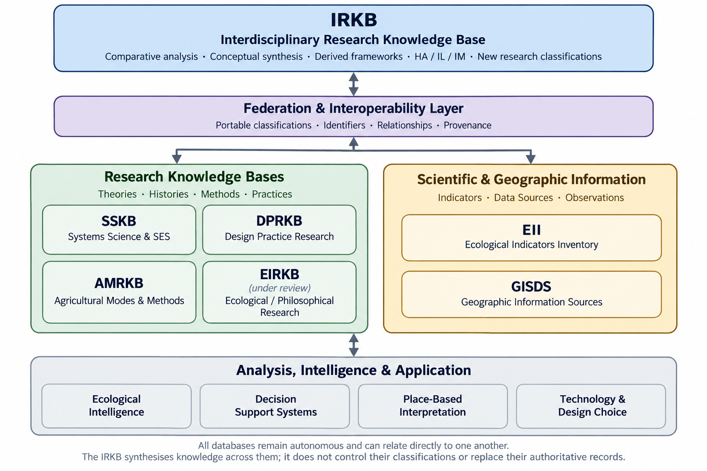

# Ecological Information

Ecological Information is the research information and knowledge-base
research layer of the Ecological Interaction ecosystem.

This umbrella is the authoritative introduction and project catalogue for
Ecological Information. Research is developed within the Ecological Interaction
ecosystem, with the academic resources attributed to their named authors.

Its purpose is to organise research references, academic positions,
ecological indicators, classifications, datasets and associated metadata
while preserving evidence, attribution and provenance.

## Relationship to the six research layers

Ecological Interaction comprises six complementary research layers:

1. Ecological Understanding communicates ecological knowledge through education,
   teaching and learning resources.
2. Ecological Information organises references, indicators, classifications,
   datasets and research knowledge.
3. Ecological Computation (`ecological-computation`) provides reusable methods
   for processing ecological data.
4. Ecological Intelligence develops interpretation, inference and analytical systems.
5. Ecological Infrastructure supports access, integration and deployment.
6. Ecological Generation supports the design and evaluation of ecological interventions.

These are logical research layers. Listing them does not imply that every layer
already has implemented software or an established repository.

Information provides resources that other research layers can use through
documented identifiers, metadata and exchange formats.

## Current project catalogue

### EIRKB — Ecological Information Research Knowledge Base

EIRKB concerns the history and theory of ecological information, academic
references, intellectual lineages, conceptual classifications and associated
research metadata. Its current material includes a historical and theoretical
narrative, a Markdown reference register transcribing 13 workbook sections,
two reference-register spreadsheets, and documentation of the intended
knowledge-base architecture. The protocol distinguishes identity, metadata,
classification, relationships and provenance; its classifications and research
interpretations remain provisional.

The [EIRKB repository](https://github.com/ecological-interaction/EIRKB) is
maintained independently in the Ecological Interaction GitHub organisation.
The [EIRKB research website](https://ecological-interaction.github.io/information/EIRKB/)
provides the introduction, History and Theory document and Reference Register.
The central website configuration publishes approved commit
`bbc7c0e755a2504a450272691aed6741af5aa6a7`, rather than following later
research edits automatically. Live availability was not independently
confirmed during this catalogue review.

The current project README uses “Ecological Information Research Knowledge Base”.
Its citation metadata and published introduction retain “Ecological Information
Reference Knowledge Base”; older umbrella terminology used “Ecological
Interaction Reference Knowledge Base”. These names describe source editions,
not separate repositories. A canonical-name alignment remains to be approved.

It distinguishes scholarly information, disciplinary terminology and
project analytical positions. Bibliographic records and research
interpretations should retain their sources and evidence status.

### EII — Ecological Indicator Inventory

EII concerns ecological variables, indicators and indices, including
their definitions, observations, measurements, interpretation and
relationships.

Its Scientific Reference Register is the human-readable five-column catalogue
of 235 indicators across EII Domain Taxonomy v1.0.0, comprising 15 scientific
domains. Its authoritative Machine Reference contains full-length structured
records in Markdown JSON blocks, definitions, classifications, supporting
relationships, scientific references, source routes and observation schemas.
The separately curated remote-sensing subset contains 91 indicators.

The [EII repository](https://github.com/ecological-interaction/EII) is configured
under the Ecological Interaction GitHub organisation. These are work-in-progress
research definitions, not verified monitoring standards. GISDS routes remain
candidate sources, AMRKB links remain technical context, and future IoT and
bioinformatics bindings remain unassigned. PBCKA/EIRKB interoperability and
Trails4Soil practice crosswalks are outside its active scope. EII references DRM
v1.0.0 as an intended methodology; conformance is unverified because the
authoritative specification was unavailable. Scientific verification,
bibliographic enrichment, database implementation and website integration
remain further development work.

### AMRKB — Agricultural Modes Reference Knowledge Base

AMRKB concerns agricultural modes, systems, methods, practices,
techniques, technologies and classifications.

Its current documentation defines scope and a proposed development
architecture, covering traditional, Indigenous, industrial, ecological,
experimental and emerging approaches. Research dimensions include historical
development, technical methods and infrastructure, ecological mechanisms,
place-specific suitability, labour and productive organisation. Modes, systems,
methods, practices, technologies and indicators are kept distinct. A populated
reference inventory, validated classification and database have not yet been
implemented. Its configured repository location is
[Jonathan-Minchin/AMRKB](https://github.com/Jonathan-Minchin/AMRKB); public
access and an academic website are not confirmed by this review.

### GISDS — GIS and Remote Sensing Database Sources

GISDS catalogues GIS, cartography and Earth-observation sources, including
platform capabilities, analytical download routes, access conditions and
interpretation limits. Its current `GISDS.md` register, catalogue version 1.4,
contains 25 unique resources, `RS001`–`RS025`. These include data providers,
environmental platforms, geospatial computation services and map-making tools;
they are catalogue resources, not 25 completed dataset records. The README
defines dataset-level metadata, including product/version, dates, resolution,
CRS, processing, provenance and reuse conditions. Descriptions derive from
provider documentation rather than end-to-end tests of every platform.

Its configured repository location is
[Jonathan-Minchin/GISDS](https://github.com/Jonathan-Minchin/GISDS); public access
and an academic website are not confirmed by this review. Database
implementation and cross-project integrations remain future work.

### PBCKA

PBCKA is a newly scaffolded independent catalogue project. Its full name,
research scope and catalogue structure remain to be defined. No catalogue
entries or database implementation have been added yet. It is a local Git
repository with no remote configured; no public repository or academic
website link is assigned here.

### Proposed and developing research directions

IRKB — Interdisciplinary Research Knowledge Base, SSKB — Systems Science and
SES, and DPRKB — Design Practice Research appear in the developing federation
diagrams. They are not present as independent repositories in the inspected
Ecological Information directory. These labels describe proposed or developing
research directions, not verified populated databases, implemented analytical
services or approved classifications. Their scope and relationships require
separate definition before they join the current repository catalogue.

## Repository boundaries

EIRKB, EII, AMRKB, GISDS and PBCKA are independent sibling repositories.

This umbrella contains layer documentation, a project catalogue,
coordination instructions and the historical reorganisation record.
It can maintain shared methodologies, database architecture guidance,
cross-database mappings and shared research diagrams. Individual databases
retain authority over their research documents, classifications, schemas,
identifiers and evidence. The umbrella does not duplicate their authoritative
research documents, registers, datasets or databases.

The databases are intended to operate as an interoperable federation,
retaining independent version control and explicit, evidenced relationships.
This is a research direction, not an implemented federation service.

The central MkDocs website publishes approved versions of research
documentation rather than maintaining independently edited academic copies.
EIRKB already uses a commit-pinned, checksum-verified import. Publication of
this umbrella and other projects remains a subsequent step.

The containing `ecological-information/` directory is an ordinary
organisational directory.

Repository links identify project source locations; academic website links
identify published reading interfaces. Configured remotes alone do not prove
public access. No website links are assigned to unpublished projects, and no
filesystem-relative links to sibling repositories are required.

## Shared methodology and diagrams

The [Database Reference Methodology (DRM)](DRM/README.md) introduces the
shared methodology under development for independently maintained databases.
It does not yet provide a detailed specification or certify conformance.

*Federated Knowledge Systems Architecture — a conceptual research diagram;
its proposed relationships do not imply implemented services or databases.*

## Interoperability direction

The projects should remain separate while developing compatible
identifiers, source metadata and explicit relationships. Shared conventions
must respect each project's scope and exclusions; federation does not imply
that every project has a relationship with every other project.

Planned conventions include:

- Stable project and entity identifiers with explicit cross-project mappings.
- Bibliographic metadata, citation keys and mappings to external identifiers.
- Dataset descriptions, provenance, versions, checksums and reuse conditions.
- Indicator definitions, units, measurement methods and interpretation limits.
- Agricultural classifications with documented evidence and provisional status.
- Spatial metadata identifying places, geometry sources and coordinate
  reference systems.
- Versioned schemas and documented exchange formats.

Zotero interoperability is intended to support literature management
and bibliographic exchange. EIRKB should complement Zotero rather than
replace it or directly modify its internal database.

SQLite is the planned canonical structured store for EIRKB.
AMRKB also anticipates later SQLite development. These databases are
not currently implemented.

QGIS compatibility is a future development direction for spatial
information and validated exchanges. EIRKB documentation identifies
GeoPackage and GeoJSON as intended spatial formats.

Future knowledge-graph development should preserve existing entity
identifiers, relationship meanings and assertion-level provenance.
JSON-LD and RDF are prospective representations, not current
implemented capabilities.

Shared conventions do not require identical project schemas or a
shared runtime dependency.

## Research quality and current status

The current projects are work-in-progress research and development resources.
EIRKB has a public research reading interface; other projects remain at their
documented catalogue or pre-implementation stages. They are not complete,
validated databases or established integration services.

Distinguish documented evidence, inference and project interpretation.
Keep provisional classifications and exploratory inventory entries
clearly labelled.

Project descriptions follow their current local documentation. Naming
differences between source editions, citation metadata and publication
interfaces remain explicit pending separately approved alignment.

EIRKB and EII name Jonathan Minchin, Ecological Interaction, with
[ORCID 0000-0001-8152-1796](https://orcid.org/0000-0001-8152-1796), in their
`CITATION.cff` files. Use each project's citation metadata and identify the
version or commit consulted; this catalogue does not assign new authorship
or replace project-level attribution.

Licensing and further publication decisions remain project-specific. EIRKB
and EII already contain citation metadata; GISDS and PBCKA document citation
and licensing decisions as pending. This umbrella has a configured remote at
[Jonathan-Minchin/ecological-information](https://github.com/Jonathan-Minchin/ecological-information).
Its current GitHub access and the pushed status of its two later catalogue
commits remain unverified. A configured remote is not evidence of publication.

## Historical reorganisation

The reorganisation dated 12 October 2026 established EIRKB, EII and
AMRKB as independent local repositories.

[REORGANISATION.json](REORGANISATION.json) preserves the original
five-file mapping, byte sizes and SHA-256 checksums.

Its paths are relative to the original `ecological-information/`
organisational directory. Moving the record into this umbrella does
not rebase or change those historical paths.

The original EIRKB document included an instruction to retain the
filename `EIRKB_README.md`. The approved repository mapping instead
placed it at `EIRKB/README.md`; the historical document text was
preserved unchanged. Both reference-register spreadsheet filenames
were also preserved.

The manifest describes that reorganisation from an ordinary directory.
It is not a complete account of earlier Understanding Git history.
The Understanding umbrella separately records the provenance of
historical research material now maintained in EIRKB.

This umbrella's first commit preserves the original domain README
and reorganisation manifest unchanged. Subsequent documentation
clarifies the domain architecture without changing the independent
research repositories.
