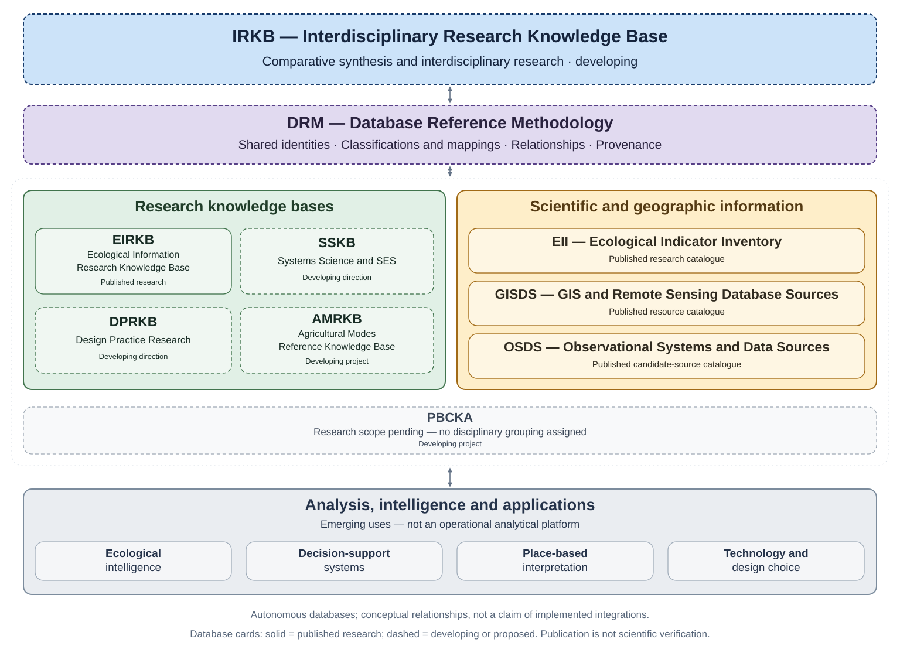

# Ecological Information

*Conceptual research architecture; relationships do not necessarily represent completed technical integrations.* [View full-size diagram](assets/diagrams/federated_knowledge_systems.svg).

## Research database directory

| Database | Research responsibility | Current status | Reading resource | Repository |
|---|---|---|---|---|
| **EIRKB — Ecological Information Research Knowledge Base** | History and theory of ecological information, references and conceptual research. | Published research; classifications remain provisional. | [Research pages](https://ecological-interaction.github.io/information/EIRKB/) | [EIRKB](https://github.com/ecological-interaction/EIRKB) |
| **EII — Ecological Indicator Inventory** | Ecological variables, indicators, measurements and qualified inferences. | Published catalogue of 235 indicators; not a validated monitoring standard. | [Scientific catalogue](https://ecological-interaction.github.io/information/EII/) | [EII](https://github.com/ecological-interaction/EII) |
| **GISDS — GIS and Remote Sensing Database Sources** | Geographic and Earth-observation resources, access routes and interpretation limits. | Published catalogue of 25 resources; product-level review remains necessary. | [Resource catalogue](https://ecological-interaction.github.io/information/GISDS/) | [GISDS](https://github.com/ecological-interaction/GISDS) |
| **OSDS — Observational Systems and Data Sources** | Observation networks, monitoring infrastructure and physical data-source discovery. | Published catalogue of 62 candidate sources, not 62 verified datasets. | [Scientific catalogue](https://ecological-interaction.github.io/information/OSDS/) | [OSDS](https://github.com/ecological-interaction/OSDS) |
| **AMRKB — Agricultural Modes Reference Knowledge Base** | Agricultural modes, systems, methods, practices and technologies. | Scope and architecture defined; public repository access unverified. | Not verified | Not publicly verified |
| **PBCKA** | Research responsibility and full name remain to be defined. | Local project scaffolding. | Not published | Not verified |
| **IRKB — Interdisciplinary Research Knowledge Base** | Comparative synthesis and interdisciplinary research across independent resources. | Developing research direction. | Not published | Not verified |
| **SSKB — Systems Science and SES** | Proposed systems-science and socio-ecological-systems research. | Developing direction; detailed scope requires definition. | Not published | Not verified |
| **DPRKB — Design Practice Research** | Proposed design-practice research and related knowledge. | Developing direction; detailed scope requires definition. | Not published | Not verified |

## Introduction

Ecological Information organises research references, scientific indicators, geographic resources, observational systems and the evidence needed to interpret them. It is the research information and knowledge-base layer of Ecological Interaction, alongside Understanding, Computation, Intelligence, Infrastructure and Generation. Its resources support researchers, designers, students and collaborators working across ecological questions and disciplinary traditions.

These resources answer different questions. Research references explain ideas and methods; indicators describe measurements and qualified interpretations; geographic catalogues identify spatial resources; observation-source catalogues locate monitoring systems and data routes. Keeping these responsibilities distinct makes their relationships easier to examine without treating a provider, an indicator and a verified measurement dataset as interchangeable.

Separate databases allow specialised research to develop while retaining its own definitions and evidence. Federation is the developing framework for connecting that work. The directory distinguishes public reading resources from components whose scope or implementation is still being developed. Publication makes a research edition accessible; it does not establish that every record, classification or data source has been scientifically verified.
